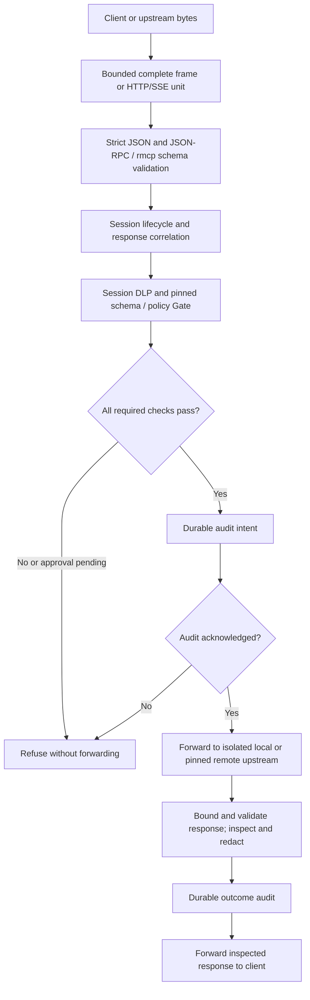

# Architecture

clawbell intercepts MCP traffic by becoming the client's configured server and
connecting to the actual upstream. Local servers run inside mandatory Linux
containment; remote HTTPS servers receive inspected traffic but their processes
are outside the local sandbox. Protection covers only traffic and execution routed
through these boundaries. Start with [README.md](README.md) for installation and
[CONTRIBUTING.md](CONTRIBUTING.md) for development.

## Responsibilities

- `crates/core`: deterministic policy evaluation, strict JSON, signatures and DLP.
  No network, process launching or audit storage.
- `crates/proxy`: bounded stdio and Streamable HTTP/SSE framing, MCP session state,
  schema/catalog pins and Gate orchestration. `protocol.rs` validates envelopes;
  private `mcp_schema.rs` isolates rmcp types and rejects custom message fallbacks.
  `policy.rs` adapts the pure policy evaluator to a session; it does not launch tools.
- `crates/sandbox`: the `Runner` interface and native process enforcement.
  `linux.rs`, `seccomp.rs` and `sys.rs` implement namespaces, pinned mounts,
  syscall filtering, pre-exec cgroup enrollment and whole-tree teardown.
- `crates/audit`: dedicated SQLite writer, durable intent/outcome records, migration
  and owner-authorized maintenance. Storage failures block new operations.
- `crates/clawbell`: CLI composition root. `launch.rs` composes session DLP,
  `PolicyGate`, audit and `NativeRunner`; `remote.rs` composes remote sessions.
  Diagnostics contain fixed reasons and redacted data, never raw packets.

Transport code depends on `Gate` and `Runner` contracts, rather than implementing
policy or isolation itself. These checks remain separate requirements: a valid
message, an allow decision or a successful scan is never sufficient on its own.
The optional UI described in AGENTS.md is not implemented in this checkout.

## Intercepted request lifecycle

1. Buffer the complete bounded inspection unit, including fragmented secrets.
   `stdio.rs` handles newline framing; `http.rs` bounds bodies and SSE events.
2. `Envelope::parse` rejects duplicate properties, invalid IDs/shapes, batches and
   unsupported methods; `Session::accept` enforces initialization and correlation.
3. The session Gate checks DLP, server/catalog identity, pinned argument schemas
   and one immutable owner policy snapshot. Deny overrides approval and allow.
   Approvals bind the operation and expire; they do not bypass another refusal.
4. Audit intent is acknowledged durably before forwarding. The Linux runner is
   established once per local session, after separately authorized/audited launch.
5. Inspect the return path too: redact before audit or disclosure. Failed transport,
   timeout and interruption leave uncertain operations unknown; never replay them.
   Cancellation tears down local descendants and cannot undo remote effects.

The diagram describes logical checks, not a single universal decorator order.
DLP must redact upstream data before inner audit; authorized local marker
restoration has a separate validation step, described in [ADR 0002](docs/adr/0002-in-flight-dlp.md).

## Security profiles and enforcement limits

[Profile instructions](policies/README.md) provide read-only and approval-required
write examples. Shell tools are opaque and denied, including `rm -rf`; skill
execution and shell grants remain disabled. Credential paths are denied even
beneath the allowed logical workspace.

Path evaluation is lexical and does no filesystem I/O. Native containment supplies
actual mount/descriptor boundaries: never mount a home or a workspace containing
`.env`, `.ssh` or other credentials. A malicious server can read everything mounted
inside its sandbox regardless of its declared tool arguments. Remote server file
access cannot be controlled by local mount policy.

See [transport boundaries](docs/adr/0001-transport-boundaries.md),
[native containment](docs/adr/0004-native-process-containment.md) and
[durable audit](docs/adr/0018-durable-wal-audit.md) for detailed contracts.
The rmcp direction-specific message types were checked through Context7 against
[the SDK model documentation](https://docs.rs/rmcp/latest/rmcp/model/index.html);
Cargo.lock remains the authority for this checkout's dependency versions.
