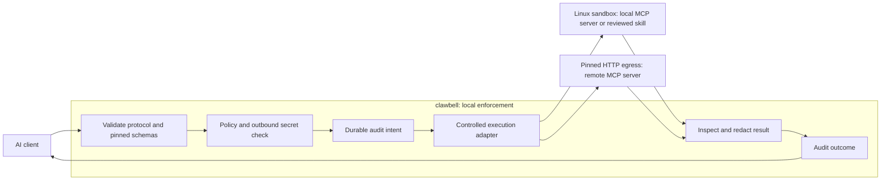

# clawbell

**Put a local security checkpoint between your AI agent and its tools.**

[](https://github.com/cierii/clawbell/actions/workflows/ci.yml)
[](LICENSE)
[](Cargo.toml)

clawbell is a local MCP firewall, sandbox and auditor written in Rust. It checks
operations against your policy, contains local processes and inspects secrets
before data crosses a controlled boundary. Cloud telemetry is disabled by default.

**See it in action after installation:**

```bash
"$HOME/.local/share/clawbell/releases/0.1.4/clawbell" demo \
  --cgroup-parent "$(systemctl --user show clawbell-delegation.service -p ControlGroup --value | sed 's|^|/sys/fs/cgroup|')"
```

The demo tests blocked host reads, workspace writes, network access, descendant
cleanup and refusal when audit storage fails, using disposable synthetic fixtures.
A missing prerequisite or failed assertion exits with failure.

[Quickstart](#quickstart) · [Policies](#a-firewall-rule-you-can-read) ·
[Architecture](ARCHITECTURE.md) · [CLI guide](docs/cli-guide.md) ·
[Contributing](CONTRIBUTING.md)

> **Early Linux MVP.** Native enforcement targets Linux x86-64 and AArch64.
> macOS and Windows execution fail closed. The version badge identifies source;
> downloads require published release assets and successful release gates.

## The problem: a tool connection is a trust decision

Connecting an agent directly to an MCP server or downloaded skill can expose your
files, credentials and network to code you have not reviewed. Tool descriptions,
results and skill instructions can carry prompt injection; an upstream can also
change its catalog after approval. Agent instructions alone do not enforce
operating-system permissions.

clawbell sits in the execution path. Unknown operations deny by default. Explicit
policy, pinned schemas, secret inspection and durable audit must pass before
forwarding. Local servers run in a Linux sandbox with read-only host mounts,
disconnected networking and limits over the entire process tree. Explicit network
exceptions use a policy-enforcing broker. Remote servers receive traffic controls;
their processes remain on their own hosts.

## Quickstart

Use a reviewed checkout on **Fedora 44 or Ubuntu 24.04**, as an unprivileged owner
with Bash, Git, sudo access, an active systemd user manager and HTTPS connectivity.
Provisioning downloads/builds dependencies and can take several minutes. Review
[host changes and recovery](docs/installation.md) before installation.

### 1. Clone and review

```bash
git clone https://github.com/cierii/clawbell.git
cd clawbell
```

Review `scripts/install.sh`, `scripts/install.py` and the installation guide.
Choose a private, **credential-free** workspace containing your reviewed server.
The whole mounted workspace is readable by that server; never select your home,
credential directories or a repository containing secrets.

### 2. Install and wrap your client

For example, place this strict JSON in your client's MCP configuration file,
replacing the script path with your reviewed server:

```json
{
  "mcpServers": {
    "workspace-reader": {
      "command": "/usr/bin/python3",
      "args": ["-B", "/absolute/path/credential-free-server/server.py"]
    }
  }
}
```

```bash
bash scripts/install.sh --config /absolute/path/client.json \
  --workspace /absolute/path/credential-free-server
```

The installer provisions dependencies and persistent cgroup delegation, runs a
real containment self-test, then replaces the entry with a clawbell wrapper.
Private backups and hash receipts allow reversible binding. Discovery never runs
the upstream. JSONC, ambient credential environments and unsupported configuration
options refuse; see [binding formats](docs/cli-guide.md#install-and-bind-a-client).

### 3. Review policy and pin the catalog

Review `~/.local/share/clawbell/policy.toml` against your upstream's tool names,
effects and path arguments, then validate it:

```bash
"$HOME/.local/share/clawbell/releases/0.1.4/clawbell" policy check \
  --file "$HOME/.local/share/clawbell/policy.toml"
```

Restart your AI client. **The first tool listing intentionally refuses**, staging
a hash-only catalog proposal. Stop sessions using that state directory, review
the upstream source and [accept the exact proposal](docs/cli-guide.md#deadlines-and-database-maintenance),
then reconnect. Catalog acceptance never overrides a policy denial. Approval rules
also require a connected [owner monitor](docs/cli-guide.md#host-diagnostics-and-approval-monitor).

For a prepared Linux host, see [manual setup](docs/cli-guide.md#install-and-bind-a-client).
For checksummed binaries with provenance verification, see
[release installation](docs/cli-guide.md#try-a-release-without-compiling).

## Architecture at a glance



Denial, unavailable isolation or failure to persist an intent blocks execution.
The Cargo workspace separates pure policy/DLP (`core`), MCP sessions (`proxy`),
process isolation (`sandbox`), SQLite history (`audit`) and CLI composition
(`clawbell`). Tokio coordinates I/O; `rmcp` supplies MCP types, `jsonschema`
validates arguments, and `reqwest` with rustls handles controlled HTTP.
See the [request flow and trust boundaries](ARCHITECTURE.md).

## A firewall rule you can read

This complete TOML policy allows only a declared `read_file` tool whose `/path`
argument falls under the logical `workspace` prefix. Everything else denies:

```toml
version = "workspace-reader-1"

[[tools]]
name = "read_file"
effect = "read"
paths = ["/path"]

[[rules]]
tool = "read_file"
path_prefix = "workspace"
decision = "allow"
```

Save it outside the mounted workspace, then run
`clawbell policy check --file /absolute/path/policy.toml` before binding.
Tool names and JSON pointers must match your pinned upstream. `workspace` is a
logical argument prefix, not a host mount declaration. A process can directly
read files already mounted in its sandbox, irrespective of tool-argument rules.

Decisions are `allow`, `deny` or `require_approval`; deny always wins. Approval is
single-use and bound to the exact invocation and policy. A write rule alone grants
no writable host mount. See the complete [security profiles](policies/README.md)
and separate [transactional publication mode](docs/cli-guide.md#transactional-mcp-operations-explicit-linux-mode).

## Why clawbell?

- **One reviewable enforcement path.** Policy, catalog/schema pins, DLP and audit
  sit between the agent and execution, reducing reliance on repeated safety
  instructions in every agent prompt.
- **Local control with bounded permissions.** A native Rust binary, Linux process
  isolation and explicit network capabilities keep decisions and audit history
  on your machine, without requiring a cloud account.
- **Less integration and recovery work.** Reversible client bindings, reusable
  policy profiles, host self-tests and terminal approvals provide concrete setup,
  review and troubleshooting tools.

## MVP roadmap

Checked items exist in the implementation; they do not certify every integration
or host. Unchecked items are proposed priorities for the next weeks, relative to
development resuming, rather than delivery commitments.

- [x] Strict TOML policies, default deny, schema validation and catalog review pins.
- [x] Local stdio proxy with Linux namespaces, bubblewrap, seccomp and cgroups v2.
- [x] Bounded text/JSON secret inspection, redaction and FULL-durable SQLite audit.
- [x] Reversible client installer, host diagnostics, demo and terminal approvals.
- [x] Static skill inspection and execution bound to a reviewed package snapshot.
- [x] Pinned remote Streamable HTTP relay, explicit OAuth and named network broker.
- [x] Per-operation staging and owner-approved publication of supported existing
  UTF-8 file changes, with a durable recovery journal.
- [x] CI definitions for dependency/secret scans, Linux checks and attested release
  packaging; inspect the linked CI run for its actual outcome.
- [ ] **Weeks 1–2:** guided catalog/policy review, clearer setup diagnostics and
  additional reproducible MCP compatibility fixtures.
- [ ] **Weeks 3–4:** optional local audit/approval panel with strict TypeScript,
  React and Vite, backed by loopback-only axum/SSE with token authentication,
  Host/Origin validation and CSRF protection.
- [ ] **Weeks 5–6:** owner-defined audit retention and archive discovery, preserving
  an append-only record of authorized maintenance.
- [ ] **Later:** additional transaction file operations after explicit recovery
  contracts, and feasibility review for native macOS/Windows enforcement.

## Security limits and verification

clawbell cannot recognize every prompt injection, encoded secret or malicious
server. Static scans and content hashes do not establish safety. Processes outside
the runner and traffic bypassing the proxy remain outside enforcement. Remote
processes are not locally sandboxed. Audit history is not tamper-proof against
the owner or an administrator.

The current interface is CLI/owner IPC; there is **no web panel or general HTTP
tool-execution listener**. OAuth may use a temporary loopback login callback.
Transactional publication supports a narrow file subset and is not atomic across
files; interruption can have partial effects. Review the
[operational security contracts](docs/cli-guide.md#security-composition) before use.

Run `bash scripts/check-local.sh` for development checks. Native enforcement and
release gates additionally require `bash scripts/check-release.sh` on a prepared
Linux host. Published [evaluation results](docs/evaluation.md) describe their
specific corpus and host, not a universal latency guarantee.

Read [SECURITY.md](SECURITY.md) for private vulnerability reporting and release
verification, [CONTRIBUTING.md](CONTRIBUTING.md) for development setup, and
[AGENTS.md](AGENTS.md) for project contracts. Technical references:
[official Rust MCP SDK](https://github.com/modelcontextprotocol/rust-sdk),
[SDK transport documentation](https://docs.rs/rmcp/latest/rmcp/transport/index.html)
and [bubblewrap](https://github.com/containers/bubblewrap).

## License

[MIT](LICENSE) © 2026 clawbell contributors.
